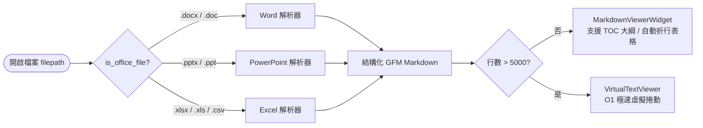

# 📊 mdreader — Office 檔案格式（Word / PowerPoint / Excel）支援可行性評估與實作方案

[English Version](office_support_plan.md)

> **評估目標**：在不破壞 `mdreader` 輕量、跨平台（macOS / Linux）、支援 Python 3.9 ~ 3.14+ 以及純終端機 TUI 體驗的前提下，評估加入 Microsoft Office 檔案格式（Word `.docx`/`.doc`、PowerPoint `.pptx`/`.ppt`、Excel `.xlsx`/`.xls`/`.csv`）閱讀支援的可行性與具體實作架構。

---

## 一、可行性總結（Executive Summary）

- **可行性評級**：**高（Highly Feasible）** —— 與 `mdreader` 現有架構高度契合。
- **核心設計哲學**：**「Office 轉結構化 GFM Markdown → 複用既有渲染與導航引擎」**
  `mdreader` 目前已採用相同模式處理 HTML（透過 [`src/mdreader/renderer/html.py`](../src/mdreader/renderer/html.py) 的 `html_to_markdown()` 轉為 Markdown 後交由 [`MarkdownViewerWidget`](../src/mdreader/widgets/markdown_view.py) 或 [`VirtualTextViewer`](../src/mdreader/widgets/virtual_viewer.py) 渲染）。
- **直接繼承的既有優勢**：
  只要將 Word、PowerPoint、Excel 轉換為標準 GFM Markdown，即可**零額外成本**直接獲得以下所有功能：
  1. **智慧表格排版**：自動享有 v1.8.1 的 **WRAP 視窗寬度配適與儲存格自動換行**，以及 **NOWRAP 水平捲動 (`h`/`l`)**。
  2. **大綱選單快速跳轉 (`O` / TOC 側欄)**：
     - Word 的 `Heading 1 ~ 6` 自動成為章節大綱。
     - PowerPoint 的每張投影片（`## Slide N: 標題`）自動成為大綱節點，可一鍵過濾並跳轉至特定投影片。
     - Excel 的每個工作表（`## Sheet: 工作表名稱`）自動成為大綱節點，可在多工作表間瞬間切換。
  3. **全文檢索與書籤**：`/` 檔案內搜尋、`m`/`'` Vim 書籤皆可直接使用。
  4. **匯出與命令列管線**：支援 `e` / `--export-html` 直接將 Office 文件匯出為獨立美觀的 HTML，或以 `--inline` 在終端機管線中直接預覽。

---

## 二、專案環境約束與技術選型比較

### 2.1 硬性環境約束
1. **Python 3.9 ~ 3.14+ 跨版本相容**：
   叢集環境中包含 Rocky Linux 9（Python 3.9.25）與 Ubuntu 26.04.1 / macOS（Python 3.14+），所選套件**絕不能要求 Python >= 3.10**。
2. **無須強制安裝系統級巨型依賴**：
   Linux 伺服器通常為 Headless 無桌面環境，預設不應強制要求安裝數百 MB 的 LibreOffice 或 Pandoc，必須以 `pipx` / `uv` 可自動安裝的輕量 Python 套件（加上標準庫保底）為主。

### 2.2 技術方案評比

| 評估方案 | 採用技術 | Python 3.9 相容 | 依賴體積 | 渲染品質 | 評估結論 |
| :--- | :--- | :---: | :---: | :---: | :--- |
| **方案 A（推薦）：專用輕量套件 + 標準庫 OOXML 保底** | `python-docx` + `python-pptx` + `openpyxl`（並內建 `zipfile` + `xml.etree` 零依賴保底解析） | ✅ 支援 (3.7~3.14) | 輕量 (~5MB) | ⭐⭐⭐⭐⭐ | **首選方案**。純 Python/Wheel 安裝極快，結構控制最精準。 |
| **方案 B：Microsoft `markitdown`** | 微軟開源 `markitdown` 套件 | ❌ **不支援** (需 >=3.10) | 龐大 (>100MB，含語音/PDF/ONNX 等) | ⭐⭐⭐⭐ | **淘汰**。違反 Rocky Linux 9 (Python 3.9) 相容性，且依賴過重。 |
| **方案 C：外部 CLI 工具轉換** | `pandoc` / `libreoffice --headless` / `antiword` | ✅ 視系統而定 | 極大 (系統需額外安裝 500MB+) | ⭐⭐⭐ | **僅作為舊版二進位 `.doc`/`.ppt` 的選用 Fallback**。 |

---

## 三、各檔案格式轉換與呈現設計



### 3.1 Word 文件（`.docx` 為主，`.doc` 選用支援）
- **套件**：`python-docx`（搭配內建 `zipfile` 解析 `word/document.xml` 作為 fallback）。
- **轉換規則**：
  1. **文件資訊列**：若含有標題/作者 Metadata，於頂部生成簡潔資訊區塊。
  2. **標題階層 (`Heading 1` ~ `Heading 6`)**：對應轉為 `#` ~ `######`，直接整合進 `mdreader` 大綱模式。
  3. **行內樣式與超連結**：保留粗體 (`**`)、斜體 (`*`)、底線與超連結 (`[文字](URL)`，支援 `gx` 開啟)。
  4. **清單項目 (`List Bullet` / `List Number`)**：依縮排層級轉為 `-` 或 `1.`，無縫銜接 v1.8.2 的多層清單縮排。
  5. **表格 (`Table`)**：按順序提取儲存格文字（自動將儲存格內換行轉為 `<br>` 或空白），輸出為 GFM 表格 `| Col1 | Col2 |`。
  6. **舊版 `.doc` 處理**：偵測系統是否有 `antiword`、`textutil -convert txt -stdout`（macOS 內建！）或 `soffice`；若無則顯示友善提示建議轉存為 `.docx`。

### 3.2 PowerPoint 簡報（`.pptx` 為主）
- **套件**：`python-pptx`（搭配內建 `zipfile` 解析 `ppt/slides/slide*.xml` 作為 fallback）。
- **轉換規則**：
  1. **投影片分頁與大綱化**：
     每張投影片轉為一個二級標題與水平分隔線：
     ```markdown
     ## 📽️ Slide 1: 專案架構總覽
     ```
     使用者按下大綱鍵即可看到所有投影片標題並快速跳轉。
  2. **文字框與階層項目 (`TextFrame`)**：
     依照段落 `level (0, 1, 2...)` 轉換為多層次清單（`•` → `◦` → `▪`）。
  3. **投影片內嵌表格 (`has_table`)**：
     提取列與欄轉為 GFM Markdown 表格。
  4. **講者備忘稿 (`has_notes_slide`)**：
     若該頁有備忘稿，於該頁底部以引用區塊呈現：
     ```markdown
     > 📝 **講者備忘稿 (Notes)**：本頁重點在於說明沙盒安全邊界...
     ```

### 3.3 Excel 試算表（`.xlsx` / `.xls` / `.csv` / `.tsv`）
- **套件**：`openpyxl`（`.xlsx`）、Python 標準庫 `csv`（`.csv`/`.tsv`）；舊版 `.xls` 可選配 `xlrd`。
- **轉換規則**：
  1. **唯讀串流與公式取值**：
     使用 `openpyxl.load_workbook(filepath, read_only=True, data_only=True)`，直接讀取公式計算後的數值（而非 `=SUM(A1:A10)` 字串），並大幅降低記憶體消耗。
  2. **多工作表分頁 (`Sheet`)**：
     每個非空白工作表轉為獨立的二級標題章節：
     ```markdown
     ## 📊 Sheet: 2026Q4營收明細 (120 列 × 8 欄)
     ```
  3. **自動修剪空白邊界 (Auto-Trim Empty Rows/Cols)**：
     自動過濾掉尾端全空的列與欄，避免 Excel 常見的數千行空白格影響閱讀。
  4. **大型工作表保護機制**：
     - 單一工作表預設渲染前 `500` 列為 GFM 表格（若超過則於表尾顯示 `> ⚠️ 僅顯示前 500 列（共 N 列）`）。
     - 若轉換後總行數超過 `LARGE_FILE_LINE_THRESHOLD (5000)`，自動交由 `VirtualTextViewer` 以固定欄寬高速渲染。

### 3.4 PDF 文件（`.pdf`）
- **套件**：`pypdf>=4.0.0`（純 Python 實作，支援 Python 3.9 ~ 3.14+，零系統級 C 編譯依賴）。
- **轉換規則**：
  1. **加密檢查**：若 PDF 受密碼保護，先嘗試空密碼解密；若仍鎖定則顯示友善提示 `> 🔒 此 PDF 檔案受密碼保護，無法直接預覽`。
  2. **文件 Metadata 標頭**：自動提取 PDF Title 與 Author 顯示於文件頂部。
  3. **分頁章節與大綱跳轉**：每頁轉為二級標題 `## Page N / Total`，使用者按下大綱鍵即可直接跳轉至指定頁碼。

---

## 四、程式碼修改切入點（Surgical Integration Plan）

遵循專案 **Rule 2 (Simplicity First)** 與 **Rule 3 (Surgical Changes)**，僅需新增 1 個渲染模組並於 4 個既有檔案加上判斷鉤子：

### 4.1 新增模組：`src/mdreader/renderer/office.py`
負責所有 Office 檔案偵測與 Markdown 轉換：
- `OFFICE_EXTENSIONS = (".docx", ".doc", ".pptx", ".xlsx", ".xls", ".csv", ".tsv")`
- `is_office_file(filepath_or_name: Path | str | None) -> bool`
- `get_office_type_label(filepath_or_name: Path | str | None) -> str`（回傳 `"Word"` / `"PowerPoint"` / `"Excel"` 供狀態列顯示）
- `office_to_markdown(filepath: Path, max_excel_rows: int = 500) -> str`
  - 內含 `_docx_to_markdown(filepath)`、`_pptx_to_markdown(filepath)`、`_xlsx_to_markdown(filepath)`、`_csv_to_markdown(filepath)`，以及標準庫 `zipfile + xml.etree.ElementTree` 的零依賴 fallback。

### 4.2 修改現有模組清單

| 檔案路徑 | 修改位置與內容 | 目的 |
| :--- | :--- | :--- |
| [`pyproject.toml`](../pyproject.toml) | 於 `dependencies` 新增 `"python-docx>=1.1.0"`, `"python-pptx>=0.6.23"`, `"openpyxl>=3.1.0"`（皆相容 Python 3.9+） | 提供完整 Word / PPT / Excel 解析能力 |
| [`src/mdreader/app.py`](../src/mdreader/app.py) | 1. `__init__` 與 `open_file()`：當 `is_office_file(filepath)` 為真時，不呼叫 `filepath.read_text(encoding="utf-8")`（避免二進位檔觸發 `UnicodeDecodeError`），改呼叫 `office_to_markdown(filepath)`。<br/>2. 狀態列 (`StatusBar`)：顯示 `Word` / `PowerPoint` / `Excel` 檔案類型標籤。<br/>3. `action_edit_file` (`v`/`F4`)：阻擋以 `vim` 開啟二進位 Office 檔，改提示或以系統預設程式開啟。 | 主程式載入、切換檔案與狀態列顯示 |
| [`src/mdreader/__main__.py`](../src/mdreader/__main__.py) | CLI 直接執行 `mdreader file.docx`、`--inline` 或 `--export-html` 時，若 `is_office_file(filepath)` 為真，先經由 `office_to_markdown(filepath)` 取得 Markdown 內容 | 支援命令列直接開啟、管線輸出與轉出 HTML |
| [`src/mdreader/widgets/file_picker.py`](../src/mdreader/widgets/file_picker.py) | 1. `supported_exts` 加入 `.docx`, `.doc`, `.pptx`, `.xlsx`, `.xls`, `.csv`, `.tsv`。<br/>2. 新增專屬檔案圖示：`📘` (Word)、`📙` (PowerPoint)、`📗` (Excel/CSV)。 | 讓 `o` 模糊檔案選擇器預設就能看到並選取 Office 檔案 |
| [`src/mdreader/widgets/virtual_viewer.py`](../src/mdreader/widgets/virtual_viewer.py) | `should_use_virtual_viewer()`：對已轉為 Markdown 的 Office 內容，比照 Markdown 檔案（僅在行數 `> 5000` 時才切換至 `VirtualTextViewer`，否則使用 `MarkdownViewerWidget` 渲染表格與標題） | 確保一般大小的 Office 檔案以美化表格與標題渲染 |

---

## 五、分階段實作時程與驗證計畫（Verification Plan）

### Phase 1：核心轉換引擎與單元測試（`src/mdreader/renderer/office.py`）
1. 實作 `.docx`、`.pptx`、`.xlsx`、`.csv` 轉 GFM Markdown 轉換器與 OOXML 標準庫保底解析。
2. 編寫單元測試 `tests/test_office_renderer.py`：
   - 動態生成測試用 `.docx`（含標題、多層清單、中日文表格）、`.pptx`（含多頁投影片、表格、備忘稿）、`.xlsx`（含多工作表、公式、空白行列），驗證轉出的 Markdown 結構與特殊字元跳脫。

### Phase 2：TUI 檢視器、File Picker 與 CLI 整合
1. 串接 `app.py`、`__main__.py`、`file_picker.py` 與 `virtual_viewer.py`。
2. 編寫 Headless TUI 整合測試：
   - 測試在 `MDReaderApp` 開啟 `.docx` / `.pptx` / `.xlsx` 時不會發生 `UnicodeDecodeError`。
   - 測試 WRAP 模式下 Excel 與 Word 表格自動折行顯示且不出現 `…` 截斷。
   - 測試大綱模式（TOC）可正確列出投影片與工作表名稱。
3. 依據 **Rule 15** 將 Minor 版本號提升（`1.8.4` → `1.9.0`），並更新中英文 `README` 與 `user_manual`。
